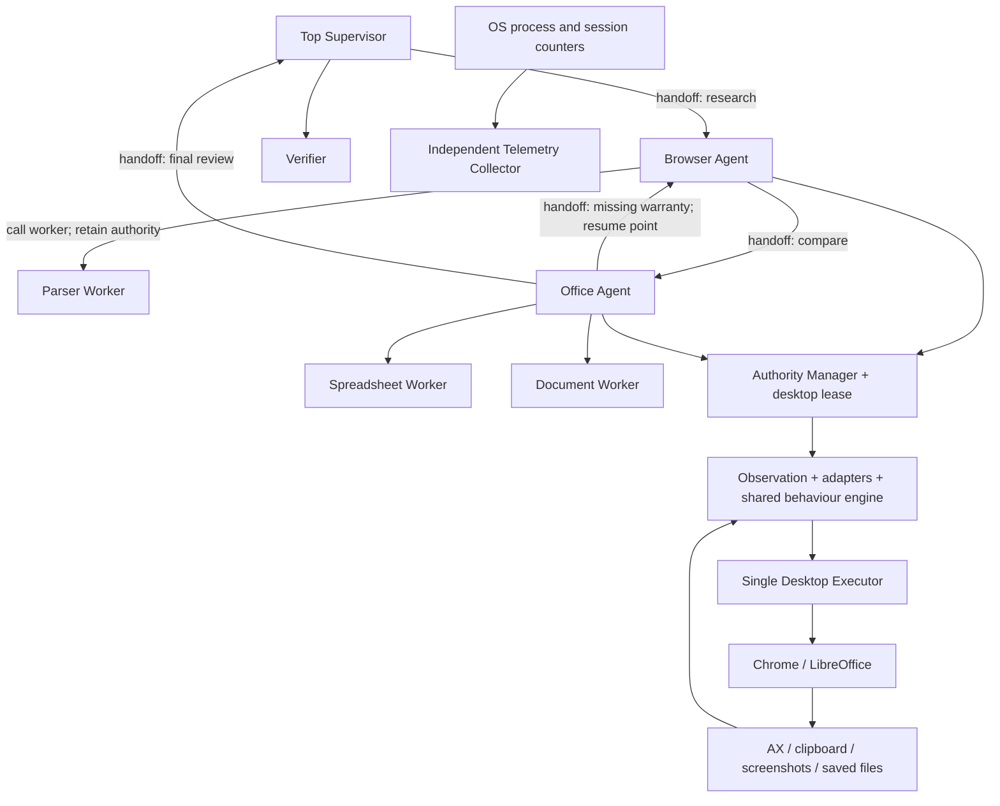

# Synthetic Human Agent

A Python MVP for **browsing a catalog, comparing three products, and creating a spreadsheet
and report**, with direct Browser/Office handoffs based on expertise. Authority management
and desktop leases are enforced in code; one Desktop Executor emits all mouse and keyboard input.

Source: [Levi3110/synthetic-human-agent](https://github.com/Levi3110/synthetic-human-agent)
(private repository).

**Verified status:** the complete workflow has run through the actual **Google Chrome and
LibreOffice Calc/Writer 26.8.1** interfaces: 22 verified actions, 5 handoffs, 20 cells and a
source-consistent report. All **7 requested activity checks** passed, including independently
observed input, four corrected typing errors and four AX-verified viewport movements.
**66 tests pass.** See [native evidence](examples/native/README.md).

This is a bounded local-catalog scenario, not a general natural-language office assistant.
The retained human comparison is available in [the human-05 benchmark](docs/HUMAN_05_BENCHMARK.md).
It reveals substantial timing differences and represents **one person's session, not a universal
human baseline**. People differ in typing, editing, shortcuts, navigation and problem-solving;
matching one person cannot establish general human likeness. The checklist is not a competition
grade, and no maximum authenticity score has been demonstrated. The [four-criterion benchmark](docs/FOUR_CRITERIA_BENCHMARK.md)
now covers Process Telemetry Authenticity (30%), Human Entropy & Timing (30%), Complexity
(20%, Secondary) and Resource Efficiency (20%, Primary), with native measurements and nine
new simulation-core trials clearly distinguished.

Screen Recording is now enabled and actual screenshots have been checked. A real **3-minute
10-second, 1080p** GUI video is available locally as `dist/synthetic-human-agent-demo.mp4`.
See [recording evidence](examples/recorded-demo/README.md) and [recording instructions](docs/DEMO.md).
Video and screenshot pixels are excluded from Git.

## Run the simulation

Python 3.11+; development verification used Python 3.14.6 on macOS ARM64.

```bash
uv sync --locked --extra dev
uv run sha doctor
uv run sha run --output runs/demo
uv run sha inspect runs/demo
uv run pytest -q
```

`uv run` uses the environment declared in `pyproject.toml` and `uv.lock`. Without uv:

```bash
python3 -m venv .venv
source .venv/bin/activate
python -m pip install -e '.[dev]'
sha run --output runs/demo
```

The simulation does not control applications: its test double retrieves the fixture over HTTP
and writes ODF files to verify orchestration and correctness. Behavioural delays are sampled
but not slept in real time. Artifacts and metrics are labelled simulation and cannot establish
native input timing or human authenticity.

## Run the macOS GUI

```bash
uv sync --locked --extra dev --extra desktop
brew install --cask libreoffice
uv run --extra desktop sha doctor --backend macos
uv run --extra desktop sha run --backend macos --output runs/desktop-demo
```

Prepare the machine:

1. Install Chrome and LibreOffice. Open both once and finish first-launch dialogs.
2. Under **System Settings → Privacy & Security → Accessibility**, allow the application that
   launches Python. This development session uses **Visual Studio Code**. macOS may require
   quitting and reopening the launcher after a permission change.
3. Enable **Screen & System Audio Recording / Screen Recording** for checkpoint screenshots
   and video. Enable **Input Monitoring** for independent passive input telemetry. Without
   Input Monitoring, the workflow can run but cannot supply independent input timing evidence.
4. Keep the desktop unlocked. Use English/US locale, standard shortcuts and normal application
   windows, with onboarding popups dismissed. Leave mouse, keyboard and focus undisturbed.
5. Run `doctor`: Accessibility and both applications must be available. Screen Recording is
   optional for task execution; missing access is recorded in observations.

Live mode delivers text and shortcuts through a private Quartz event source with explicit
key codes, text and modifier flags. PyAutoGUI emits mouse/wheel events, and macOS AX reads
interface state. Keys and modifiers are released in `finally`, including on cancellation.
Browser text is read through Select All/Copy, so the demo changes the session clipboard.
Links are clicked at AX-provided positions, with keyboard activation as a labelled fallback.

Before scrolling, the runtime moves the pointer inside the AX web area, including on secondary
monitors, then verifies content-anchor movement relative to the viewport. Calc receives text
cell by cell, uses Tab within a row, and saves/verifies each row. Writer receives prose with
occasional immediately corrected errors. Cmd+S saves both files; ODF is read independently to
verify the output. In live mode, code creates only **empty** seed documents.

Output uses native **`comparison.ods` and `report.odt`**, with LibreOffice substituting for
Microsoft Excel/Word. Microsoft Office, Pages/Numbers and GUI XLSX/DOCX export are not supported.
Runs have been checked with Chrome at negative X coordinates on a secondary display and
Office on the primary display, and with both on the recorded primary display. Other layouts,
custom shortcuts/locales, advanced formatting and native non-English typing remain unverified.

## Workflow and authority



The Supervisor holds mission authority; Browser/Office hold phase authority. Each action
acquires a desktop lease. Owner, epoch and token are checked before every input, including
individual characters and mouse-path points. Workers return data/plans and cannot access the
executor or acquire authority.

The demo first collects catalog prices. Office detects missing warranty data and hands back
to Browser with a specific question. Browser opens the detail pages and returns authority to
`office_create`. A handoff carries a checkpoint, data version, completion criteria and resume
point. The receiver accepts its inputs; the runtime drains current input; SQLite atomically
updates owner/epoch/continuation; the receiver re-observes before continuing.

See [architecture](docs/ARCHITECTURE.md), [weighted evaluation protocol](docs/EVALUATION.md),
[demo/submission instructions](docs/DEMO.md) and [validation](docs/VALIDATION.md).
`sha assess RUN_DIRECTORY` checks [activity evidence](docs/ACTIVITY_ASSESSMENT.md).

## Run artifacts

| File | Contents |
| --- | --- |
| `comparison.ods`, `report.odt` | Simulation-generated or GUI-entered native documents, explicitly labelled |
| `state.sqlite` | Mission, versioned products, authority, action journal, checkpoints and file digests/history |
| `audit.jsonl` | Intent, dispatched input, observations, timing, retries, handoffs and verification |
| `telemetry.jsonl` | Independent OS CPU/RSS/thread samples, I/O when available, and live session counters |
| `inputs.jsonl` | Passive CGEventTap metadata: timestamps, press pairing, pointer/wheel events; no characters/raw key codes |
| `evidence/*.txt`, `*.json` | Observed page text, URLs, digests and observations |
| `evidence/*.png` | Live checkpoint screenshots when access is available |
| `metrics.json` | Outcome, action mix, handoffs, timing, model calls/tokens and resources |
| `settings.json` | Configuration used for the run |

Application totals include all matching Chrome/LibreOffice processes, including unrelated
sessions. `runner_peak_*` isolates Python. The first CPU sample may be zero; sampling cannot
capture spikes shorter than its interval. macOS process I/O may be unavailable. Session counters
include other user activity and cannot be attributed exclusively to the agent. Passive-only
foreground samples can be stale; the human-05 report excludes them from dwell-time conclusions.

## Stop, retry and restart

Move the pointer to the upper-left corner to trigger PyAutoGUI's fail-safe, or create STOP:

```bash
touch runs/desktop-demo/STOP
```

Ctrl+C also interrupts execution. One CLI runtime per OS user can hold the desktop lock.
Commands with stale epochs/tokens are rejected. An expired lease remains quarantined because
the old executor could still be inside an OS call. After it exits, the OS lock is released;
resume advances the epoch and reconciles actual files/desktop state against the journal.

```bash
uv run sha inspect runs/demo
uv run sha run --output runs/demo --resume
```

Inspect state before removing STOP. `set_cell`, `set_cells` and `write_document` do not retry
unknown outcomes automatically. If the persisted postcondition is already correct, reconciliation
marks completion without typing again. Otherwise, unresolved edits block resume. Read/navigation/
open operations have bounded retries with an observation before another attempt. The Supervisor
can recover read/open failures to the appropriate specialist/resume point up to `max_recoveries`.
Retain evidence and use a new run directory after addressing an unresolved mutation's cause.

## Models and configuration

`configs/demo.json` defaults to deterministic role policies in code for an offline, reproducible
MVP. LangGraph routes agent nodes; SQLite stores durable continuation state. Parsing, spreadsheet/
document planning and simple verification use code. There is no per-keystroke LLM call or
continuous vision loop.

An optional shared Ollama-compatible gateway can choose schema-constrained handoffs. Set
`model_url` to an available server, such as `http://127.0.0.1:11434`, and `model_name` to an
installed model. The gateway uses `/api/chat`, timeout/schema checks and reported token usage.
Routing remains capability/state constrained; the model cannot extend scope or grant authority.
This gateway has been tested against a local stub, not a real model. It does not make the MVP
a general-purpose planner. The default requires no API key.

One persona persists RNG/rhythm across applications: correlated typing speed, variable holds,
word/sentence pauses, reading/app-switch delays, corrected adjacent-key errors in prose,
curved mouse paths and wheel bursts. URLs/emails, numbers and formulas are protected.
`pause_scale` does not change application wait time. Requested-delay entropy alone cannot
establish similarity to humans; more randomness is not automatically more realistic.

## Benchmarks and human baselines

Follow the [manual baseline guide](docs/HUMAN_BASELINE.md) to serve the catalog independently
while the recorder listens to manual work.

```bash
uv run sha benchmark --runs 9 --output runs/bench/current.json
uv run sha evaluate --agent runs/recorded-native-demo-final --human runs/human-05 --core runs/bench/current.json --output runs/benchmarks/four-criteria
uv run --extra desktop sha capture-human --seconds 600 --output runs/human-baseline
uv run sha compare --agent runs/desktop-demo/inputs.jsonl --human runs/human-baseline/inputs.jsonl --output runs/comparison.json
uv run python scripts/benchmark_report.py --agent runs/desktop-demo --human runs/human-baseline --output runs/benchmarks/closed-pair --archive-raw
```

The fresh-process simulation benchmark measures core CPU/wall time/RSS without real-time
behavioural sleep or the OS sampler. [Optimization results](docs/OPTIMIZATION.md) do not describe
GUI throughput. The [human-05 report](docs/HUMAN_05_BENCHMARK.md) separately compares recorded
native input with one manual session, preserves unfavourable differences and leaves the weighted
score unassigned. `sha evaluate` adds process-pattern diagnostics, fresh artifact checks and
resource measurements across all four dimensions. It writes `benchmark.json`, an English report
and a weights/status CSV; it reuses existing native evidence and sends no desktop input.
Raw human traces remain local; aggregate results and provenance hashes are published.

`capture-human` emits no input and holds the desktop lock to prevent concurrent agent execution.
Stop immediately after the task, before running compare. Comparison requires correct labels,
at least 30 active intervals per side, closed start/stop lifecycles and no reported capture errors.
Missing evidence produces `insufficient_evidence`. `idle_seconds` is the legacy inter-key gap
measure reset by shortcuts; `input_silence_seconds` measures gaps over two seconds between any
observed input events. Neither identifies why a person paused. Mouse velocities are event-wise
and sampling-sensitive. Correction events include deliberate editing, not just typing mistakes.

High-frequency traces batch up to 64 events, preserve original timestamps and flush at action/
checkpoint/close boundaries. A hard crash can lose buffered diagnostic trace events; action
intents and authority fencing remain durable before input. SQLite durability is not disabled.

## Development

```bash
uv run pytest -q
uv run ruff check src tests scripts
uv run ruff format --check src tests scripts
```

Code is under `src/synthetic_human`. Tests cover fenced handoffs, input exclusivity, reconciliation
without duplicate edits, file/source verification, capture quality and complete workflow variants.
Extend adapters and postcondition checks when adding applications; keep input behind the executor.
