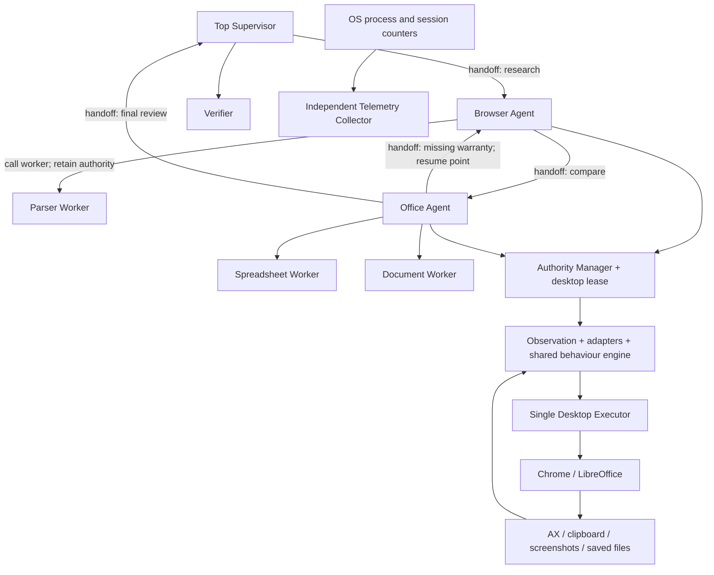

# Synthetic Human Agent

MVP Python cho workflow **duyệt catalog → so sánh ba sản phẩm → tạo bảng tính và báo cáo**,
với Browser/Office handoff trực tiếp theo chuyên môn. Authority Manager và desktop lease được
thực thi bằng code; mọi input đi qua một Desktop Executor.

Mã nguồn: [GitHub — Levi3110/synthetic-human-agent](https://github.com/Levi3110/synthetic-human-agent)
(repository riêng tư).

**Trạng thái bàn giao:** đã chạy thành công workflow qua GUI thật trên **Google Chrome +
LibreOffice Calc/Writer 26.8.1**, với 22 hành động xác minh, 5 handoff, 20 ô và báo cáo đúng
nguồn. Checklist hoạt động đạt **7/7**; có telemetry input độc lập, 4 lỗi gõ được sửa và
4 lần cuộn xác minh bằng AX. **53 test đạt**. Xem [bằng chứng native](examples/native/README.md).
Đây là MVP theo kịch bản catalog cục bộ, chưa hỗ trợ mọi yêu cầu văn phòng bằng ngôn ngữ
tự nhiên. Chưa có baseline người thật để chấm authenticity. Screen Recording đã được cấp và kiểm tra
bằng ảnh thật. Đã quay video GUI thật **3 phút 10 giây, 1080p**; bản MP4 nằm tại
`dist/synthetic-human-agent-demo.mp4` trên máy bàn giao. Xem [bản ghi](examples/recorded-demo/README.md)
và `docs/DEMO.md` để quay lại. Không coi 7/7 checklist là điểm thi hoặc
chứng minh tối ưu toàn cục.

## Chạy ngay bằng backend kiểm thử

Python 3.11+; bản bàn giao được kiểm tra bằng Python 3.14.6 trên macOS ARM64.

```bash
uv sync --locked --extra dev
uv run sha doctor
uv run sha run --output runs/demo
uv run sha inspect runs/demo
uv run pytest -q
```

`uv run` dùng môi trường được khai báo trong `pyproject.toml` và `uv.lock`. Nếu không dùng uv:

```bash
python3 -m venv .venv
source .venv/bin/activate
python -m pip install -e '.[dev]'
sha run --output runs/demo
```

Simulation **không điều khiển ứng dụng**: test double duyệt fixture bằng HTTP và ghi ODF để
kiểm chứng logic. Thời gian hành vi được lấy mẫu nhưng không sleep theo thời gian thực. Các
file và metrics đều gắn nhãn simulation; không dùng chúng làm bằng chứng telemetry người thật.

## Chạy GUI macOS

```bash
uv sync --locked --extra dev --extra desktop
brew install --cask libreoffice
uv run --extra desktop sha doctor --backend macos
uv run --extra desktop sha run --backend macos --output runs/desktop-demo
```

Các bước chuẩn bị cần làm trên máy chạy demo:

1. Cài Chrome và LibreOffice, mở hai ứng dụng một lần để hoàn tất hộp thoại lần đầu.
2. Trong **System Settings → Privacy & Security → Accessibility**, bật quyền cho ứng dụng
   khởi chạy Python, ví dụ Terminal hoặc Codex. Có thể cần thoát/mở lại ứng dụng đó.
   Phiên phát triển hiện tại chạy Codex qua **Visual Studio Code**, nên cần cấp quyền cho
   **Visual Studio Code** và thoát/mở lại VS Code sau khi thay đổi.
3. Bật **Screen & System Audio Recording / Screen Recording** cho ứng dụng khởi chạy nếu
   cần screenshot checkpoint. `doctor` chỉ kiểm tra, không tự hiện yêu cầu cấp quyền.
   Bật **Input Monitoring** để thu metadata input độc lập qua event tap. Thiếu quyền này,
   workflow vẫn có thể chạy nhưng không có bằng chứng thời gian input độc lập.
4. Để máy ở phiên đăng nhập có desktop đang mở khóa. Dùng cửa sổ LibreOffice bình thường,
   locale English/US, phím tắt mặc định và tắt các popup onboarding. Không chuyển focus khi chạy.
5. Chạy `doctor`: Accessibility và hai ứng dụng phải sẵn sàng. Screen Recording là tùy chọn
   cho screenshot; thiếu quyền sẽ được ghi trong Observation.

Live mode phát ký tự và phím tắt bằng Quartz với event source riêng, mã phím và modifier flags rõ ràng;
PyAutoGUI phát chuột/cuộn, macOS AX đọc giao diện. Mỗi phím được nhả trong `finally`, kể cả khi hủy tác vụ.
Browser đọc nội dung qua thao tác Select All/Copy trên trang; clipboard của phiên demo sẽ thay đổi.
Link được click khi AX cung cấp vị trí, hoặc kích hoạt bằng phím Enter khi không tìm được vị trí.
Khi cuộn, con trỏ được di chuyển vào vùng trang bằng tọa độ AX, kể cả màn hình phụ;
runtime xác minh các mốc nội dung dịch chuyển tương đối với viewport trước khi ghi thành công.
Calc được nhập từng ô qua GUI, dùng Tab trong một hàng và lưu/kiểm chứng mỗi hàng;
Writer nhận đoạn văn có lỗi gõ được sửa ngay. Hai file được lưu
bằng Cmd+S và kiểm tra bằng cách đọc lại ODF. Chỉ file mẫu **rỗng** được tạo bằng code trong live mode.

Đầu ra sử dụng định dạng native **`comparison.ods` và `report.odt`**, thay Microsoft Excel/Word
bằng LibreOffice. Chưa hỗ trợ adapter Microsoft Office, Pages/Numbers hoặc export DOCX/XLSX qua GUI.
Đã chạy với Chrome ở màn hình phụ có tọa độ X âm và LibreOffice ở màn hình chính.
Bố cục nâng cao, cấu hình màn hình khác và locale/phím tắt tùy biến chưa được kiểm chứng.

## Workflow và quyền



Supervisor giữ mission authority; Browser/Office giữ task authority. Desktop lease được cấp
cho từng action và kiểm tra lại trước **mỗi input**, kể cả ký tự và điểm di chuyển chuột.
Worker chỉ trả dữ liệu/kế hoạch, không có reference tới executor hoặc authority.

Demo cố ý lấy giá từ catalog trước. Office phát hiện thiếu bảo hành, chuyển cho Browser với
câu hỏi cụ thể. Browser mở từng trang chi tiết và trả quyền về `office_create`. Handoff lưu
checkpoint, phiên bản dữ liệu, điều kiện hoàn thành và resume point; receiver xác nhận input;
runtime chờ action đang chạy kết thúc; SQLite cập nhật owner/epoch/continuation nguyên tử;
receiver quan sát lại desktop trước bước tiếp theo.

Xem [thiết kế chi tiết](docs/ARCHITECTURE.md), [đánh giá theo trọng số](docs/EVALUATION.md),
[kịch bản video và bàn giao GitHub](docs/DEMO.md) và [kết quả kiểm chứng](docs/VALIDATION.md).
Để chấm theo danh sách hoạt động bạn yêu cầu, dùng `sha assess RUN_DIRECTORY` và xem
[bảng bằng chứng theo tiêu chí](docs/ACTIVITY_ASSESSMENT.md).

## Kết quả mỗi lần chạy

| File | Nội dung |
| --- | --- |
| `comparison.ods`, `report.odt` | File native; simulation tạo bằng test double, live mode nhập qua GUI |
| `state.sqlite` | Mission, sản phẩm có version, quyền, action journal, checkpoints, file digests/version history |
| `audit.jsonl` | Ý định, input đã dispatch, observation, timing, retry, handoff và verification |
| `telemetry.jsonl` | OS samples độc lập: CPU/RSS/threads/I/O khi có; live có session input counters khi API khả dụng |
| `inputs.jsonl` | Live: metadata từ passive CGEventTap, gồm timestamp input, key hold, chuột/cuộn; không lưu ký tự hoặc key code |
| `evidence/*.txt`, `*.json` | Nội dung trang thực sự quan sát, URL, digest và observation |
| `evidence/*.png` | Screenshot checkpoint nếu live có quyền |
| `metrics.json` | Tình trạng hoàn thành, loại hành động, handoff, timing, model calls/tokens, tài nguyên |
| `settings.json` | Cấu hình đã dùng |

App process metrics bao gồm **mọi** Chrome/LibreOffice process trong phiên, kể cả cửa sổ không
thuộc agent. Metrics riêng `runner_peak_*` đo process Python. CPU mẫu đầu có thể bằng 0;
thread sampler không ghi nhận được spike ngắn hơn chu kỳ. Process I/O trên macOS có thể không khả dụng.
Session counters có cả hoạt động khác của người dùng và không phải sự kiện được gán riêng cho agent.

## Dừng, retry và restart

Di chuyển con trỏ về góc trên trái để kích hoạt PyAutoGUI fail-safe; hoặc tạo file STOP:

```bash
touch runs/desktop-demo/STOP
```

Ctrl+C cũng dừng phiên. Chỉ có một CLI runtime trên mỗi tài khoản OS được giữ desktop lock.
Lệnh hết epoch hoặc token sẽ bị từ chối. Lease hết hạn không được tự chiếm lại: runtime cũ
có thể đang treo trong lời gọi OS. Sau khi process cũ đã kết thúc, OS lock được giải phóng;
resume tăng epoch, đối chiếu file/desktop với checkpoint và xử lý journal.

```bash
uv run sha inspect runs/demo
uv run sha run --output runs/demo --resume
```

Không xóa STOP cho đến khi đã kiểm tra trạng thái. `set_cell`/`set_cells`/`write_document` không tự retry
khi kết quả chưa rõ. Nếu file đã có postcondition đúng thì reconcile đánh dấu hoàn thành,
không gõ lại. Nếu chưa có bằng chứng, phiên dừng để Supervisor review. Các thao tác đọc,
navigation URL và mở file có tối đa `max_retries`, có observation trước lần thử lại.
Supervisor có thể phục hồi lỗi đọc/mở file về đúng chuyên gia và resume point, tối đa
`max_recoveries` lần. Action chỉnh sửa chưa rõ kết quả vẫn chặn resume đến khi có postcondition
đúng; không tự gõ lại. Giữ bằng chứng để điều tra và dùng thư mục run mới sau khi xử lý nguyên nhân.

## Model và cấu hình

`configs/demo.json` dùng policy theo vai trò bằng code để demo chạy offline, tái lập và tiết kiệm.
LangGraph điều phối các node agent; SQLite là nguồn checkpoint/continuation bền vững.
Parser, spreadsheet/document planning và verifier ưu tiên code. Không có LLM gọi theo từng phím
hoặc vòng vision liên tục.

Có gateway dùng chung một model Ollama-compatible cho quyết định handoff có schema. Để bật,
đặt `model_url` thành `http://127.0.0.1:11434` và `model_name` thành model đã tải sẵn. Gateway
dùng endpoint `/api/chat`, có timeout, schema validation và ghi prompt/output tokens khi
server trả về. Trong demo, route được giới hạn theo capability và trạng thái, nên model không
thể mở rộng mục tiêu hay tự cấp desktop authority. Gateway này **chưa kiểm chứng với model thật**;
nó không biến MVP thành planner đa nhiệm tự do. Bản mặc định không yêu cầu API key.

Persona dùng chung xuyên ứng dụng, lưu RNG/rhythm trong trạng thái phiên: tốc độ có tương quan giữa
ký tự, khoảng giữ phím biến thiên, ngắt theo cụm từ/câu, pause đọc và đổi app, typo theo phím
lân cận có sửa trong văn xuôi, đường chuột cong khi click, cuộn theo burst. URL/email, số và công thức
không bị cố tình gõ sai. `pause_scale` không tác động thời gian chờ ứng dụng. Entropy hiện là
thống kê của **khoảng thời gian được yêu cầu**, không phải chứng minh agent giống người thật.

## Benchmark và baseline người dùng

Xem [hướng dẫn thu baseline từng bước](docs/HUMAN_BASELINE.md), gồm cách mở catalog riêng
để bạn thao tác thủ công trong lúc recorder chỉ nghe telemetry.

```bash
uv run sha benchmark --runs 9 --output runs/bench/current.json
uv run --extra desktop sha capture-human --seconds 180 --output runs/human-baseline
uv run sha compare --agent runs/desktop-demo/inputs.jsonl --human runs/human-baseline/inputs.jsonl --output runs/comparison.json
```

Benchmark dùng các process mới và scenario mô phỏng giống nhau, đo CPU/thời gian/RSS của
lõi, không bao gồm sleep hành vi realtime hoặc OS sampler. Kết quả tối ưu và raw trials nằm
trong [báo cáo tối ưu](docs/OPTIMIZATION.md). Không diễn giải tốc độ mô phỏng thành tốc độ GUI.

`capture-human` chỉ nghe sự kiện, không phát input; giữ desktop lock để agent không chạy
đồng thời và làm nhiễu baseline. Hãy tự thực hiện cùng workflow trong thời gian ghi. Collector
ghi metadata toàn phiên đăng nhập, không lưu ký tự/key code. `compare` báo KS/Wasserstein cho
khoảng gõ, giữ phím, idle và tốc độ chuột; không tự cho điểm theo rubric. Thiếu quyền, ít hơn
30 khoảng gõ, sai nhãn agent/human hoặc có khoảng mất dữ liệu sẽ báo `insufficient_evidence`.

Trace tần suất cao được batch tối đa 64 event, flush ở ranh giới action/checkpoint và khi đóng.
Timestamp được lấy khi sự kiện xảy ra. Crash cứng có thể mất phần trace còn buffer; action
journal và fencing vẫn ghi bền vững trước input. Không tắt durability của SQLite để lấy tốc độ.

## Phát triển

```bash
uv run pytest -q
uv run ruff check src tests scripts
uv run ruff format --check src tests scripts
```

Source nằm trong `src/synthetic_human`; test tập trung vào fencing/handoff, input exclusivity,
reconcile không nhập trùng, file/source verification và workflow hoàn chỉnh. Khi thêm ứng dụng,
mở rộng adapters và postcondition verifier thay vì cho agent phát input trực tiếp.
