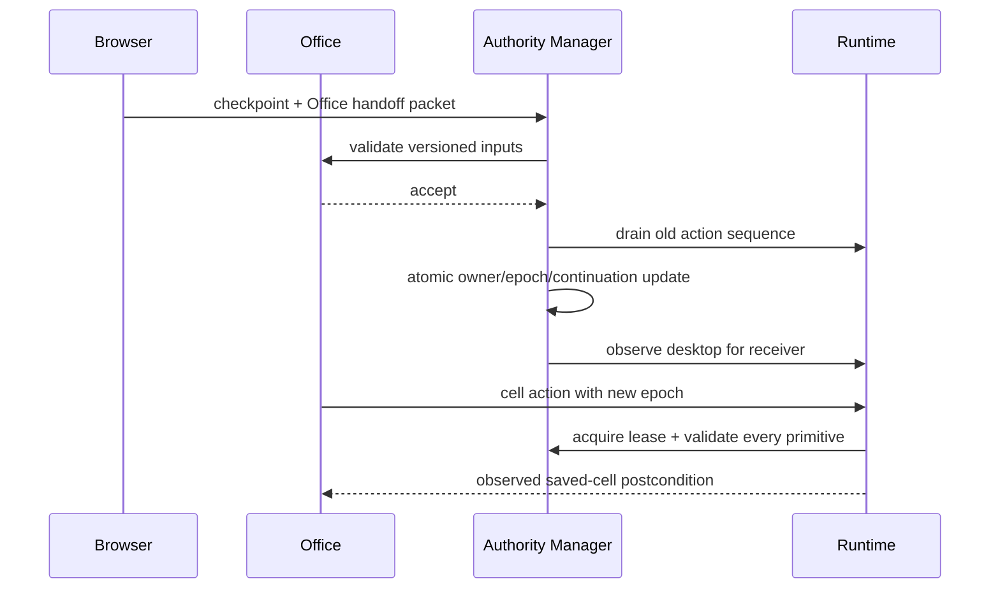

# Architecture and contracts

## Responsibility boundaries

| Component | Decision scope | Input/output |
| --- | --- | --- |
| Top Supervisor | Mission, phase assignment, success criteria, failure review | Mission → expert handoff or final verifier |
| Browser Agent | Catalog and detail browsing within the mission | Observed page evidence → versioned products |
| Office Agent | Completeness, spreadsheet/report coordination | Products → worker plans → GUI actions |
| Parser Worker | Deterministic fixture extraction, schema validation | Observed text → Pydantic Product |
| Spreadsheet Worker | Cell/formula planning | Products → `(cell, value)` pairs |
| Document Worker | Consistent report text | Products → document text |
| Verifier | Independent source/file consistency | ODF, evidence and products → checks/errors |
| Authority Manager | Ownership, fencing, lease, handoff budgets | Versioned contracts → atomic authority transition |
| Observation | AX application/window/focus, clipboard and screenshot evidence | Read-only observed state |
| Behaviour Engine | Shared persona and contextual pacing | Intent → timed individual input events |
| Executor | The sole OS input writer | Fenced primitive → OS dispatch |
| Collector | Actual process/session measurements | OS → append-only JSONL samples |

Agents are in-process graph nodes, not separate model services. This avoids idle LLM processes
and duplicated contexts. Parallel computation can be added for pure workers, but a single
desktop cannot be used concurrently. A role-specific prompt does not grant authority.

## Action contract

```json
{
  "id": "unique-operation-id",
  "owner": "office",
  "epoch": 4,
  "kind": "set_cell",
  "target": "/absolute/run/comparison.ods",
  "payload": {"cell": "D2", "value": "=B2*1.08"},
  "expected": {},
  "goal": "calculate tax-inclusive cost"
}
```

Each adapter defines the postcondition for its action. Spreadsheet mutations verify the saved
cell/formula; `set_cells` batches one contiguous row, saves once, and verifies **every** cell.
Partially saved/ambiguous rows are not replayed blindly. Report mutations verify the saved text; navigation verifies copied observed
page text; open-file verifies the focused window title. Scroll is dispatch-acknowledged only:
viewport displacement is not independently verified in this MVP. The graph adds source reads
after scrolling so information extraction still requires page evidence.

The runtime writes `running` before input, then `done` only after observing the postcondition.
Lease acquisition and initial action intent are committed in the same transaction. The engine
persists its random generator/rhythm state after action completion or interruption, so a
resumed session does not reset its style.
Failures/cancellation write `uncertain`. Exactly-once OS input delivery is not assumed. Logical
mutations use stable IDs plus file-state checks; successful results with lost acknowledgments
are reconciled without repeating input. Unknown outcomes stop the workflow. A manual rollback
of artifacts is detected rather than silently accepting a cached operation.

## Handoff protocol

1. Sender stores checkpoint with source data version, file digests and resume point.
2. Authority Manager validates checkpoint and current data version.
3. Receiver validates required inputs and explicitly accepts; no desktop rights yet.
4. Runtime drains any currently executing input sequence through an `asyncio.Lock`.
5. SQLite `BEGIN IMMEDIATE` checks owner/epoch/lease and **rechecks** the data version.
6. The same transaction changes owner, increments epoch, stores continuation, commits handoff.
7. Receiver observes desktop while the runtime gate is still held, then may plan the next action.

Browser and Office transfer directly. Supervisor is notified by persisted events; it is not a
mandatory intermediary for every action. A bounded no-progress counter and total handoff
budget force escalation. Supervisor retains mission scope even when Browser/Office owns execution.
The Verifier does not receive input rights; final verification runs under Supervisor mission control.



## Concurrency and restart

SQLite WAL provides durable authority/action state within a run database; the CLI obtains a
per-user OS `flock` **across run directories** before creating a desktop backend. In-process
`asyncio.Lock` serializes actions and authority transitions. A lease token and expiry are
checked before every primitive, including each typed character and mouse movement point.
An expired but outstanding lease is quarantined until the owning process has stopped.

Resume first obtains the same OS lock, increments the authority epoch and clears the abandoned
lease. This relies on all desktop runtimes being launched through the supplied CLI; embedding
the library in another service must preserve the same global lock contract. State continuation
is committed with authority, so restart routes to the receiver even if a crash happened after
the transfer but before the previous LangGraph node returned.

Source-product updates and their version increment are one transaction. Saved files have SHA256
version history. A checkpoint stores versions/digests, not full file backups; automatic rollback
of partially typed unsaved documents is not supported. Failed review is persisted and not retried
indefinitely. The local fixture restarts on its recorded loopback port, preserving source URLs.

## Timing and resource accounting

The engine keeps a seeded session persona, correlated typing rhythm and small fatigue factor.
Character latency is sampled from a positive skewed distribution, with added word/sentence
pauses. Reading pauses depend on observed text length; app switches have their own distribution.
Typos are restricted to prose and corrected before the next intended character. Mouse movement
uses a smooth curved path and distance-dependent duration when link coordinates are available.
Scrolling divides wheel input into varying bursts with read pauses; learned viewport-dependent scroll
models are future work. The single-person comparison in [HUMAN_05_BENCHMARK.md](HUMAN_05_BENCHMARK.md)
does not establish human equivalence; people differ in timing and task strategy.

Timing categories separate requested/elapsed behaviour, application wait/verification, and
runtime overhead. Unicode key-down/up events have a sampled hold interval; cancellation releases
the held key in a `finally` block. URLs/emails and numeric/formula input are protected from typo
injection. Sender screenshots are reused as handoff evidence; the receiver still obtains a fresh
AX/focus observation after authority commits, avoiding a duplicate screenshot without any UI action.
Overhead includes adapter expansion, AX reads, driver dispatch, logging and
file inspection. Retry overhead may include a failed verification wait; these aggregate metrics
are diagnostic rather than a complete profiler. Model latency is recorded separately.

The collector thread reads OS measurements without consuming commands. Audit dispatch events
describe what the runtime attempted; they are not substituted for OS measurements. macOS
session counters are cumulative and include other user input. No kernel, network or application
event streams are fabricated. Process metrics are sampled, so short-lived process events and
sub-sample spikes may be missed.

A separate [passive CGEventTap](https://developer.apple.com/documentation/coregraphics/cgeventtapoptions/listenonly)
records native input timestamps and metadata when Input Monitoring is available. It neither
consumes executor commands nor records characters/raw key codes. Missing permission, queue
overflow and tap disablement are explicit coverage records. The listener has run on real agent
and manual sessions; see [VALIDATION.md](VALIDATION.md). Process reads use
[psutil oneshot](https://psutil.readthedocs.io/stable/index.html) to avoid redundant system calls;
dead process cache entries are pruned. Metrics stream over records rather than loading the
entire audit/telemetry into memory. Audit JSON export preserves prevalidated JSON bodies to
avoid repeated decode/encode work.

High-frequency audit records batch up to 64 events, or flush on the next event after 250 ms,
and at action/transaction/export/close boundaries. Action intent and authority transactions remain
fully durable. A hard crash can lose buffered trace records; it cannot convert an unknown mutation
into a successful result. No SQLite durability PRAGMA has been weakened for benchmark results.

## Scope, extensions and references

Only the local, explicitly labelled fictional catalog has a deterministic parser in this MVP.
Browser navigation itself supports ordinary URLs, but general web research, dynamic site login,
arbitrary article parsing, rich document formatting, tabular visual editing, and unconstrained
natural-language planning need additional adapters and evaluations. Screenshot evidence is
captured at checkpoints, not continuously. Optional `sha ocr IMAGE` uses tesseract on a saved
image; automatic OCR-driven target grounding is not implemented.

For a Windows deployment, implement the same observation/executor contracts with
[Microsoft UI Automation](https://learn.microsoft.com/en-us/windows/win32/winauto/uiauto-uiautomationoverview)
and collect genuine OS traces with [ETW](https://learn.microsoft.com/en-us/windows/win32/etw/event-tracing-portal).
Those adapters are not included here. LangGraph routing follows its
[StateGraph API](https://reference.langchain.com/python/langgraph/graph/state/StateGraph/add_conditional_edges).
An observability backend can later ingest real signals using
[OpenTelemetry](https://opentelemetry.io/docs/concepts/signals/); this MVP exports local JSONL.

## Telemetry and persona review

The [latest review](OPTIMIZATION_REVIEW.md) adds a main-loop foreground heartbeat with explicit
freshness, live per-sample PID discovery/CPU/RSS/thread reads, and a five-second stable-metadata
cache with recorded age and matched-PID reuse fencing. Nonmatching PID exec/reuse can take up
to that TTL to reclassify. Independent input events and their original timestamps are unchanged.
Frequent focus checks read app/document identity without extracting full editor text. Browser
verification uses one fresh clipboard snapshot for both matching and evidence persistence.

Persona defaults preserve legacy sessions. Optional configurable hold/typing distributions and
independent serial holds support the explicitly in-sample human-05 profile; overlapping key
holds remain unsupported. Larger entropy or closer fit to one person is not a universal score.
